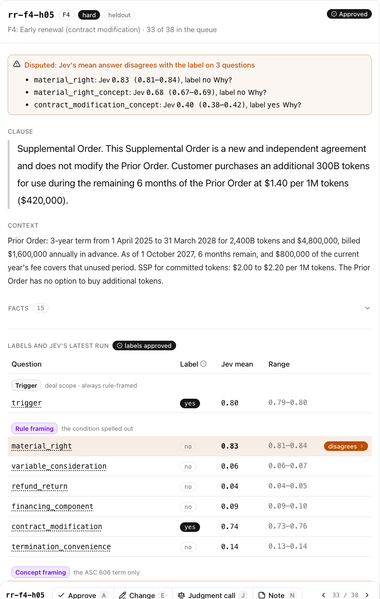
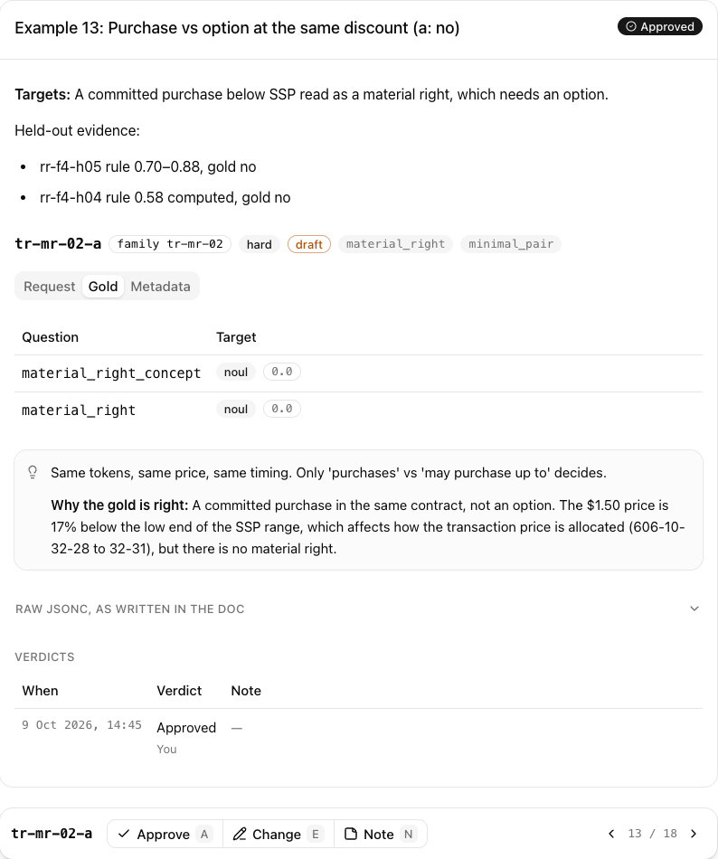

# finance-decision-evals

An evaluation of TypeSafe's calibrated decision model, Jev (`jev-1.13.0`), on a revenue accounting
task. Jev reads one non-standard software contract clause and decides whether the deal needs a
revenue accounting review, and which ASC 606 issues the clause raises. I built the evaluation from
my experience as a revenue accounting manager and deal-desk lead, where this review was my job.

The [results page](https://jev-revrec.victorlau.dev) tells the story; its code is in
[`site/`](site/). The full write-up is [`rev-rec/report.md`](rev-rec/report.md).

## What I found

Test set: 20 synthetic clauses, 3 runs each. The issue rows give the share of answers right across
six ASC 606 issues.

| Question | Clause as written | Facts computed in code |
|---|---|---|
| Does the deal need a revenue accounting review? | 18 of 20 clauses | 20 of 20 |
| Which ASC 606 issues apply? Rule written out | 94% | 94% |
| The same, asked by the term's name | 89% | 87% |

- **Computing the facts fixed the review call,** but not naming the issue. Jev reads ASC 606 terms
  of art such as "material right" in their everyday sense.
- **Most remaining errors are about structure.** With the rule written out and the facts computed,
  every remaining error is a false alarm. Three trace to my question wording. Four come from how
  Jev reads a clause, such as a committed purchase read as an option.
- **Jev's middle answers belong with a person.** In that same setup, every answer below 0.5 was
  right. Answers between 0.5 and 0.7 were right only about half the time.
- **Training data could close the gap.** I built [six minimal pairs](rev-rec/training-examples.md).
  Each pair keeps the clause the same and changes only the fact that decides the answer.

## How the work was done

- **Clauses from facts.** A script generates the 20 test clauses from structured facts. The 17
  development clauses were written one by one, and I used them to shape the questions. In both sets,
  code computes or checks the amounts, dates and gaps
  ([`build-heldout.ts`](rev-rec/scripts/build-heldout.ts),
  [`check-cases.ts`](rev-rec/scripts/check-cases.ts)). Nothing is copied from a real contract.
- **Labels.** The clause families and label rules come from my ASC 606 deal-desk experience. Claude
  drafted the clauses and labels from my notes and rules, and I reviewed and approved every one.
  Two independent AI reviews labelled the test clauses blind first
  ([`rev-rec/reviews/`](rev-rec/reviews/)). Every verdict is logged in
  [`reviews.jsonl`](rev-rec/data/reviews.jsonl).
- **A locked test set.** I locked the 20 test clauses and their labels before Jev saw them
  ([`heldout-freeze.json`](rev-rec/data/heldout-freeze.json)).
- **Two axes.** Each issue is asked two ways: by the ASC 606 term's name, and with the rule written
  out. The facts are given three ways: as written, as named fields, and as named fields plus
  comparisons computed in code. Together they separate reading errors from knowledge errors
  ([`eval-design.md`](rev-rec/eval-design.md)).
- **Every call logged.** Each request and response is in [`rev-rec/runs/`](rev-rec/runs/), with the
  model version, tokens and cost. Follow-up checks are in [`probes/`](probes/).

## How I review labels

Every label goes through a small review console I built for this project. It runs locally and reads
the clauses, runs and training records straight from these files. Its only write appends one line
per verdict to [`reviews.jsonl`](rev-rec/data/reviews.jsonl). The console's code isn't in this repo;
these screenshots show what it does.

**A test clause.** The clause and deal facts as Jev saw them. Below them, my label for each question
sits beside Jev's mean answer and its range over the 3 runs. The console flags any question where
Jev's answer falls on the other side of 0.5 from my label. Here Jev reads a committed purchase as an
option: it answers 0.83 on material right, and my label is no.



**A training record.** Three tabs follow the record format. Request is what the model sees. Gold is
the correct answer to each question, 0 for no and 1 for yes. Metadata holds the facts the clause was
built from, and why the answer is right. Verdicts are listed under the record.



**The log.** Each verdict is one JSON line: the item, the verdict, who gave it, when, and a snapshot
of the item as it stood. An approval can always be checked against the record as it is now.

## Repository

```
rev-rec/
  report.md               full write-up
  training-examples.md    the six training pairs, readable
  families.md             the four clause families tested
  eval-design.md          the two axes
  data/                   cases, labels, test-set lock, review verdicts, training records
  questions/              question sets v0, v1, v2
  runs/                   every Jev call, plus comparison tables
  reviews/                the two blind label reviews
  scripts/                case builders, runner, scorer, lock check, training-page renderer
probes/                   small API experiments
site/                     the results page (Next.js)
```

## Reproduce

```sh
bun install
bun rev-rec/scripts/freeze.ts check                    # test set unchanged since it was locked
export TYPESAFE_API_KEY=…                              # your own key
bun rev-rec/scripts/run.ts --split heldout --questions v2 --state computed --reps 3
bun rev-rec/scripts/score.ts rev-rec/runs/<run>.jsonl
bun run site                                           # the results page on localhost:4200
```

The test-set answers are public. The results are for `jev-1.13.0`, and a later model version may
have seen these clauses.

## License

Code: [MIT](LICENSE). Data (cases, labels, reviews, runs, training examples):
[CC BY 4.0](LICENSE-DATA.md). All cases are synthetic.
